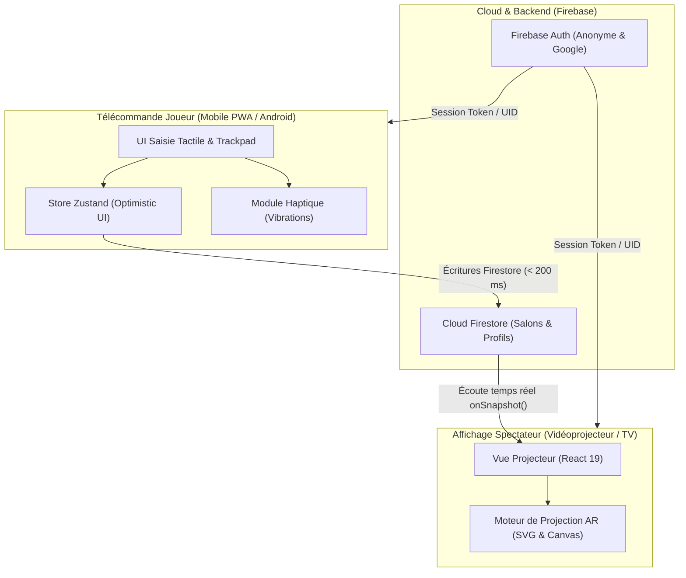
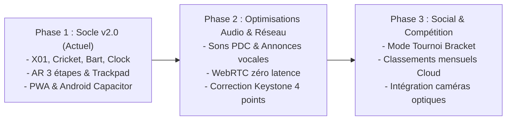

# Product Requirements Document (PRD) — Minou Dart

---

## 1. Fiche Signalétique du Produit

| Propriété | Détail |
| :--- | :--- |
| **Nom du Produit** | **Minou Dart** |
| **Version du Document** | **2.0** (Aligné sur l'architecture v2 : AR, Bart/Tennis, Clock & Optimistic UI) |
| **Statut** | **Validé / Spécification de Référence** |
| **Date de Révision** | 29 septembre 2026 |
| **Auteur / Équipe** | Ingénierie Produit & Architecture Antigravity |
| **Stack Principale** | React 19, TypeScript, Vite, Tailwind CSS 4, Zustand, Firebase (Firestore & Auth), Capacitor 8 |
| **Système Métrique** | Standard international WDF / PDC (dimensions en millimètres, virgule décimale française) |

---

## 2. Vision du Produit & Proposition de Valeur Commerciale

### 2.1. Contexte du Marché
Le marché du jeu de fléchettes se divise historiquement en deux extrêmes :
1. **Les cibles électroniques traditionnelles (Soft-Tip) :** Encombrantes, onéreuses (2 500 € à 5 000 € pour des bornes de bar type Phoenix ou Cyberdine), bruyantes, et limitées à des pointes plastiques légères qui dégradent la sensation de lancer authentique.
2. **Les cibles traditionnelles en sisal (Steel-Tip) couplées à des applications mobiles basiques :** Authentiques sur le plan mécanique, mais frustrantes sur le plan social. Les joueurs doivent manipuler un écran de 6 pouces, s'interrompre pour taper leur score, sans aucune immersion visuelle collective.
3. **Les systèmes de caméra automatique (ex: Scolia, Omni) :** Coûteux (800 € à 1 500 € l'accessoire seul), purement passifs, et incapables de projeter de la lumière ou des animations dynamiques sur la cible ou le mur.

### 2.2. La Solution Minou Dart
**Minou Dart** réinvente le jeu de fléchettes en transformant n'importe quelle cible en sisal standard en une **arène interactive augmentée**.
L'application repose sur un écosystème **bi-écran en temps réel** :
- **Un écran spectateur immersif (Vidéoprojecteur / Android TV)** : Projette les scores, les checkouts, les animations d'impact et des overlays de **Réalité Augmentée (Projection Mapping)** directement sur ou autour de la cible physique.
- **Une télécommande tactile ultra-réactive (Smartphone / Tablette)** : Optimisée pour une utilisation à une seule main au pas de tir, avec retour haptique, zéro latence d'affichage (Optimistic UI), et outils de calibrage laser.

### 2.3. Personas Cibles & Arguments de Vente (Approche "Sales")
- **Le Joueur Passionné / Compétiteur :** Recherche de précision, affichage des routes de finition optimales (suggestions de Checkout PDC/WDF jusqu'à 170 points), calcul rigoureux des moyennes sur 3 fléchettes et du MPR (Marks Per Round).
- **Le Groupe Convivial / Soirée entre amis :** Recherche de modes ludiques immédiats sans prise de tête (Tour de l'horloge, Cricket délirant, duel Bart/Tennis), interface soignée, animations visuelles valorisantes.
- **L'Exploitant de Lieu (Bar, Pub, Club, Espace de Coworking) :** Solution économique à très fort impact visuel. Elle modernise l'espace fléchettes sans modifier l'infrastructure physique, augmente le temps de rétention des clients et suscite la curiosité immédiate.

---

## 3. Architecture Technique Globale



### 3.1. Composants Logiciels
- **Frontend :** React 19 (Hooks modernes, concurrence, typage strict TypeScript).
- **Styling :** Tailwind CSS v4, icônes vectorielles Lucide React.
- **Gestion d'État Client :** Zustand avec pattern d'**Optimistic UI** (mise à jour immédiate du DOM local pour une latence perçue inférieure à 16 ms, résolution asynchrone des écritures Firebase en tâche de fond avec rollback en cas de rupture réseau).
- **Base de Données & Synchro :** Google Cloud Firestore avec écoutes réactives `onSnapshot()`.
- **Packaging Hybride :**
  - Web : Progressive Web App (PWA installable hors-ligne via `vite-plugin-pwa`).
  - Android : Application native Android générée par **Capacitor 8** (`@capacitor/android`, `@capacitor/core`) pour l'intégration plein écran et l'accès direct aux moteurs de vibration système.

### 3.2. Topologie & Norme Géométrique Métrique (WDF / PDC)
Le système intègre la géométrie physique officielle d'une cible de compétition en sisal :
- **Rayon total de la zone active de scoring ($R_{\text{double\_outer}}$) :** $170\text{ mm}$
- **Largeur des bandes de Doubles et de Triples :** $8\text{ mm}$
- **Rayon extérieur du Double ($R_{\text{double\_outer}}$) :** $170\text{ mm}$ (ratio : $1,0$)
- **Rayon intérieur du Double ($R_{\text{double\_inner}}$) :** $162\text{ mm}$ (ratio : $162 / 170 \approx 0,9529$)
- **Rayon extérieur du Triple ($R_{\text{triple\_outer}}$) :** $107\text{ mm}$ (ratio : $107 / 170 \approx 0,6294$)
- **Rayon intérieur du Triple ($R_{\text{triple\_inner}}$) :** $99\text{ mm}$ (ratio : $99 / 170 \approx 0,5823$)
- **Rayon de la Bulle extérieure (Outer Bull - 25 pts) :** $15,9\text{ mm}$ (ratio : $15,9 / 170 \approx 0,0935$)
- **Rayon de la Bulle intérieure (Inner Bull - 50 pts) :** $6,35\text{ mm}$ (ratio : $6,35 / 170 \approx 0,0373$)

**Séquence des 20 secteurs (sens horaire à partir de Midi / 12h00) :**
$$\text{Secteurs} = [20, 1, 18, 4, 13, 6, 10, 15, 2, 17, 3, 19, 7, 16, 8, 11, 14, 9, 12, 5]$$
L'algorithme de calcul applique une circularité d'ordre 20 (le secteur 5 est adjacent au secteur 20).

---

## 4. Spécifications Fonctionnelles Détaillées

### 4.1. Gestion des Utilisateurs, Profils Cloud & Salons

#### Authentification & Profils
- **Connexion :** Support de Google Sign-In pour synchroniser son identité sur plusieurs terminaux, et authentification anonyme instantanée pour les invités et salons éphémères.
- **Profils Joueurs Persistants :** Création de profils Cloud rattachés au propriétaire (`ownerId`). Chaque joueur possède un pseudonyme, un avatar emoji sélectionnable parmi 12 symboles, et des statistiques globales agrégées (parties jouées, victoires, fléchettes totales lancées, cumul des points).
- **Historique & Statistiques :** Transactions Firestore garantissant l'intégrité des victoires et des compteurs lors de la clôture d'une partie.

#### Gestion des Salons (Rooms)
- **Code de Salon Simplifié :** Génération d'un code alphanumérique unique à 4 caractères majuscules (ex: `MN42`) sans ambiguïté visuelle.
- **Connexion Instantanée QR Code :** Génération dynamique d'un QR Code vectoriel sur la télécommande pour appairer le vidéoprojecteur en un scan.
- **États d'un Salon :**
  - `setup` : Sélection des joueurs (1 à 8 joueurs), ordonnancement de l'ordre de passage, choix du mode de jeu et réglages de projection.
  - `playing` : Partie en cours avec synchronisation temps réel des lancers.
  - `finished` : Fin de match, podium du vainqueur, statistiques du match et mise à jour des fiches joueurs.
- **Reprise après Rupture / Menu d'Urgence :**
  - Mise en cache continue dans le `localStorage` de la télécommande.
  - Bouton "Reprendre la partie" proposé au redémarrage si une session a été interrompue inopinément.
  - Commandes contextuelles : **Pause**, **Retour au menu**, **Abandonner la partie** (`ABORTED`, n'affectant pas le ratio victoires/défaites des joueurs).

---

### 4.2. Moteur de Jeu X01 (101 à 1001)

#### Paramètres de Partie
- **Score initial modulable :** 101, 201, 301, 501, 701, 1001.
- **Condition de Fin (Double Out) :**
  - `true` : La fléchette victorieuse doit obligatoirement être un Double ou le Bull rouge (50).
  - `false` (Single/Master Out) : N'importe quel segment réduisant le score à 0 valide la victoire.

#### Logique de Jeu & Volées
- Découpage par joueur en tours de **3 fléchettes maximum**.
- **Gestion du Bust (Dépassement de score) :**
  - Se déclenche si le score restant passe en dessous de 0, ou s'il tombe à 1 en mode Double Out, ou s'il tombe à 0 sans terminer par un double requis.
  - En cas de Bust, le score du joueur est automatiquement réinitialisé à sa valeur du début de tour (`scoreBeforeRound`), son tour s'achève immédiatement et la main passe au joueur suivant.
- **Calcul de Moyenne Normalisée :**
  $$\text{Moyenne (3 fléchettes)} = \left(\frac{\text{Total des points marqués}}{\text{Nombre total de fléchettes lancées}}\right) \times 3$$
  Formaté avec une décimale française (ex: $64,8\text{ pts/volée}$).

#### Suggestions Officielles de Checkout (Double Out)
Intégration d'un dictionnaire officiel de combinaisons de finition validé selon les tables PDC/WDF pour tous les scores de 2 à 170.
- Exemples clés :
  - **170 :** T20 $\rightarrow$ T20 $\rightarrow$ Bull (50)
  - **167 :** T20 $\rightarrow$ T19 $\rightarrow$ Bull (50)
  - **40 :** D20
- Mise à jour dynamique à chaque fléchette lancée dans la volée : si le joueur touche un simple, le chemin restant est recalculé en temps réel pour ses fléchettes restantes.

#### Système d'Annulation (Undo)
- Annulation fléchette par fléchette avec rollback complet du score, du compteur de fléchettes, des statistiques de moyenne et restitution de la main au joueur précédent si la volée venait de changer.

---

### 4.3. Moteur de Jeu Cricket & Variantes

#### Objectif & Mécanique de Base
Fermer les 7 cibles du jeu en logeant 3 marques dans chacune (un Simple = 1 marque, un Double = 2 marques, un Triple = 3 marques). Une fois une cible fermée à 3 marques, le joueur peut y "scorer" tant qu'au moins un adversaire ne l'a pas également fermée.

#### Variantes de Cibles
1. **Cricket Classique :** Cibles traditionnelles : 15, 16, 17, 18, 19, 20 et le Bull (25/50).
2. **Crazy Cricket (Aléatoire) :** Le Bull + 6 numéros tirés au sort aléatoirement entre 1 et 20.
3. **Tactical Cricket (Aléatoire Non-Adjacent) :** Le Bull + 6 numéros tirés au sort avec l'assurance algorithmique absolue qu'**aucun secteur tiré n'est adjacent à un autre** sur la circonférence de la cible (ex: le 20 interdit le 1 et le 5). Oblige les joueurs à balayer toute la largeur de la cible.

#### Modes de Comptage des Points
- **Mode Standard :** Lorsqu'un joueur touche une cible qu'il a fermée mais qui reste ouverte chez un adversaire, les points sont ajoutés à son propre score. Le premier à fermer toutes les cibles avec un score supérieur ou égal à ses adversaires gagne.
- **Mode Cutthroat (Mort Subite) :** Les points marqués sont pénalisants et sont ajoutés aux adversaires n'ayant pas fermé le secteur. Le joueur ayant fermé toutes les cibles avec le **score le plus bas** remporte la partie.

#### Indicateurs Métriques Dédiés
- **MPR (Marks Per Round) :**
  $$\text{MPR} = \left(\frac{\text{Total des marques validées}}{\text{Nombre total de fléchettes}}\right) \times 3$$
- **Précision (%) :** Pourcentage de fléchettes ayant touché une cible utile.
- **Tours Blancs :** Compteur de volées terminées sans aucune marque enregistrée.

---

### 4.4. Moteur de Jeu "Bart" (Tennis Darts)

#### Concept & Originalité Produit
Transposition exclusive et novatrice du tennis de grand chelem sur une cible de fléchettes dans un format duel (1 contre 1).
Le jeu reproduit l'intensité, la pression psychologique et le comptage des points du tennis.

#### Système de Score Tennis
- Points d'un jeu : $0 \rightarrow 15 \rightarrow 30 \rightarrow 40 \rightarrow \text{Égalité (40-40)} \rightarrow \text{Avantage (ADV)} \rightarrow \text{Jeu}$.
- Sets & Match : Match au meilleur de 1, 3 ou 5 sets paramétrable.
- Règle du **Tie-Break** à 6 jeux partout : premier à 7 points avec 2 points d'écart. Alternance des services conforme au tennis officiel (1 service initial, puis 2 services par joueur).

#### Mécanique de Service & d'Échange
1. **Phase 1 (Choix de la Cible) :** Le Serveur choisit une zone sur la cible (ex: Secteur 20 en zone extérieure, Bull, ou Triple 19).
2. **Phase 2 (Tir & Résolution) :** Les deux joueurs tirent vers cette zone.
   - **Fléchette la plus proche :** Le joueur remporte le point (progression normale du score : +1 palier de point).
   - **Touche parfaite ("Perfect") :** Si un joueur réussit un impact direct dans la zone exacte ciblée :
     - Si c'est le Serveur : déclenchement d'un **Ace** (gain immédiat de 2 paliers de points ou gain direct de point sous animation visuelle).
     - Si c'est le Receveur : déclenchement d'un **Retour Gagnant** (*Return Winner*).
3. **Statistiques Métier Spécifiques au Tennis :**
   - Nombre d'Aces et de Retours gagnants.
   - Pourcentage de balles de break converties.
   - Efficacité au service (% de points gagnés sur son engagement).
   - **Heatmap interactive des cibles :** Analyse de la rentabilité des zones sélectionnées par le serveur (taux de succès et ratio de perfection par zone).

---

### 4.5. Moteur de Jeu "Clock" (Tour de l'Horloge)

#### Mécanique
Entraînement et jeu d'adresse où les joueurs doivent toucher chronologiquement les secteurs de 1 à 20, avec option d'inclure le Bull (25) comme cible finale.
- Progression fléchette par fléchette : une fléchette touchée incrémente la cible active du joueur ; un tir manqué passe à la fléchette suivante sans avancement.
- Mesure continue de la précision (pourcentage de réussite) et historique complet avec fonction Undo.

---

### 4.6. Système de Vidéo-Projection & Réalité Augmentée (AR)

L'application intègre trois modes de projection adaptés à tous les équipements :

```
+-----------------------------------------------------------------------+
|  MODE 1 : CLASSIQUE (Optimisé pour cible physique non éclairée)        |
|  +-------------------------+----------------------------------------+  |
|  |    CARRÉ BLANC PUR      |      ZONE D'INFORMATION DYNAMIQUE      |  |
|  |        #FFFFFF          |   - Joueur actif & Volée en cours      |  |
|  |  (Emplacement cible     |   - Suggestions de Checkout            |  |
|  |    physique en sisal)   |   - Événements de match (Aces, etc.)   |  |
|  +-------------------------+----------------------------------------+  |
|  |                 TABLEAU DES SCORES & STATISTIQUES                |  |
|  |                    (Dark Mode haute visibilité)                  |  |
|  +------------------------------------------------------------------+  |
+-----------------------------------------------------------------------+
```

1. **Mode 1 : Classique (Zone réservée)**
   - Le quart supérieur gauche (25% de l'écran) est un aplat blanc pur (`#FFFFFF`), dépourvu d'icônes ou de textes. Il est destiné à recevoir la fixation murale de la cible physique sans que la lumière du projecteur ne crée de contraste parasite sur les numéros réels.
   - Le quart supérieur droit affiche le statut du joueur actif, la volée en cours et les checkouts.
   - La moitié inférieure affiche le tableau d'ensemble des scores et statistiques en Dark Mode contrasté.

2. **Mode 2 : Plein Écran (Fullscreen)**
   - Affichage dynamique exploitant 100% de la surface d'affichage. Idéal lorsque le projecteur ou la télévision est déporté sur le côté du pas de tir.

3. **Mode 3 : Réalité Augmentée / Projection Mapping (AR)**
   - Le projecteur est aligné directement sur la cible physique et son pourtour immédiat.
   - **Fonctionnalités de Projection Mapping :**
     - Réticule laser de calibrage projeté sur le centre et les doubles.
     - Halo néon d'ambiance et dégradés lumineux réagissant aux événements de jeu.
     - Éclairage interactif en surbrillance des segments à viser (ex: mise en lumière du Double 16 lors d'une tentative de checkout).
     - Animations d'impact lors des touches réussies, des 180, des Aces ou des victoires.

#### Calibrage Millimétrique Déporté (depuis la Télécommande)
Pour éviter de manipuler un clavier ou une souris devant le mur, tous les réglages de projection s'effectuent depuis la télécommande mobile :
- **Mode Guidé ("Wizard" en 3 étapes) :**
  1. Positionnement du centre $(X, Y)$ via curseurs ou pavé directionnel.
  2. Ajustement de l'échelle / rayon extérieur ($170\text{ mm}$ étalonné sur les doubles réels).
  3. Réglage de la rotation fine ($\pm 15^\circ$) pour corriger l'assiette angulaire du 20 physique et test d'impact direct.
- **Mode Avancé & Trackpad Tactile Virtuel :**
  - Surface tactile sur mobile permettant de glisser le réticule en temps réel avec réglage de la sensibilité (pas de 1 à 20 pixels).
  - Contrôle indépendant de l'encart de statistiques : coordonnées $(X, Y)$, dimensions (largeur/hauteur), et échelle de police typographique horizontale/verticale.

---

## 5. Exigences Non-Fonctionnelles & Performance

| Critère | Exigence & Objectif | Solution Technique Mise en Œuvre |
| :--- | :--- | :--- |
| **Latence de Saisie** | $< 16\text{ ms}$ (sensation d'instantanéité) | Pattern **Optimistic UI** avec Zustand : validation immédiate du lancer dans l'UI locale avant confirmation réseau. |
| **Délai de Réplication Écran** | $< 250\text{ ms}$ | Écouteurs en temps réel Firebase Firestore `onSnapshot()`. |
| **Ergonomie Mobile** | Utilisation à une main (*One-Handed UX*) | Pavé numérique compact centré au bas de l'écran, boutons tactiles de 54 px minimum, retour vibratoire haptique. |
| **Lisibilité Spectateur** | Visibilité nette à $3,5\text{ m}$ (distance de recul) | Typographies à fort contraste, mode sombre profond (Dark Mode), composants SVG vectoriels scalables sans perte. |
| **Disponibilité Réseau** | Résilience aux micro-coupures Wi-Fi | Cache local `localStorage`, queue de synchronisation locale `pendingWrites` avec réconciliation automatique. |
| **Compatibilité Matérielle** | Tout vidéoprojecteur HD/4K, tout smartphone moderne | Ratio d'aspect responsive (16:9 natif pour le projecteur, 9:19 pour les téléphones). |

---

## 6. Analyse Critique & Recommandations d'Architecture (Rôle de Partenaire Technique)

En tant que partenaire technique critique, voici l'évaluation objective des forces et des points d'attention du système actuel :

### 6.1. Points Forts Démontrés
- **Excellente modularité logicielle :** La séparation entre les moteurs de calcul (`x01Engine`, `cricketEngine`, `bartEngine`, `clockEngine`) et les vues graphiques assure une maintenabilité exemplaire et facilite l'ajout futur de nouvelles variantes (ex: Killer, Shanghai, Split Score).
- **Gamification et Innovation Métier :** L'adaptation du Tennis ("Bart") apporte une valeur ajoutée unique sur le marché du jeu de fléchettes, idéale pour des démonstrations commerciales et des tournois festifs.
- **Expérience Utilisateur sans Couture :** Le pattern Optimistic UI élimine la frustration habituelle des applications web connectées où le joueur doit attendre la réponse du serveur pour valider sa 2ème fléchette.

### 6.2. Risques Identifiés & Pistes d'Optimisation

#### 1. Fréquence d'écriture Firestore vs Calibrage en Direct
- *Observation :* Le déplacement continu du réticule laser via le trackpad tactile peut générer des dizaines d'écritures par seconde dans Firestore.
- *Risque :* Latence perceptible lors du glissement (100 à 300 ms) et surcoût potentiel de facturation Firestore si les réglages s'éternisent.
- *Recommandation :* Découpler le calibrage en utilisant une connexion pair-à-pair directe (**WebRTC DataChannel**) ou **Firebase Realtime Database** spécifiquement pour le flux de curseur continu, et ne persister dans Firestore que la validation finale du bouton "Enregistrer".

#### 2. Correction de la Déformation Trapézoïdale (Keystone 4 points)
- *Observation :* Le système de calibrage actuel gère une translation $(X, Y)$, une mise à l'échelle uniforme et une rotation angulaire.
- *Risque :* Dans la quasi-totalité des configurations de salon, le vidéoprojecteur n'est pas placé à hauteur exacte du centre de la cible (il est soit au plafond, soit sur une table basse, créant une distorsion trapézoïdale où les cercles deviennent des ellipses).
- *Recommandation :* Remplacer la transformation SVG standard par une **matrice de transformation homographique 4 points** (Perspective Transform). L'utilisateur pointerait les 4 coins du cadre de projection ou 4 points cardinaux du double pour corriger tout angle de tir oblique.

#### 3. Détection Automatique par Caméra (Évolution V3)
- *Observation :* L'application nécessite actuellement une saisie manuelle des scores par un tiers ou par le joueur à la fin de sa volée.
- *Recommandation :* La structure de données de l'application est prête pour intégrer un flux vidéo (webcam grand angle USB ou caméra smartphone pointée vers la cible) couplé à un modèle d'inférence visuelle (Computer Vision / OpenCV.js) pour valider automatiquement les impacts sur la géométrie métrique déjà modélisée dans `boardTopology.ts`.

---

## 7. Feuille de Route Commerciale & Fonctionnelle (Roadmap)



- **Trimestre 1 :** Finalisation des bruitages et annonces vocales officielles ("One Hundred and Eighty !", "Game Shot"), amélioration du calibrage 4 coins.
- **Trimestre 2 :** Mode Tournoi Multi-Salons (arbres éliminatoires et poules pour les bars et ligues locales).
- **Trimestre 3 :** Module expérimental de détection automatique d'impact par traitement d'image.
